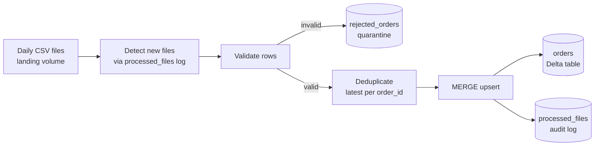

# Incremental Orders Pipeline (PySpark + Delta Lake)

An incremental data pipeline built on Databricks that loads daily order files, rejects bad records, removes duplicates and keeps one correct, up-to-date row per order using Delta Lake `MERGE`.

> Built with simulated data to practise production-style data engineering patterns: incremental loading, upserts, data quality checks, auditing and idempotent re-runs.

## Problem

An orders system drops a new CSV file every day. The files are messy:

- the same order can appear twice in one file
- some rows are invalid (missing customer, negative amount, unknown status)
- orders from earlier days come back with a new status (placed, shipped, delivered, cancelled)

The pipeline must process **only new files**, never load bad rows into the main table, and **update** existing orders instead of creating duplicates.

## Architecture



## Tech stack

Python, PySpark, Delta Lake, Spark SQL, Databricks (Free Edition, serverless), Git/GitHub

## How it works

1. **Find new files:** lists the landing folder and skips any file already recorded in `processed_files`.
2. **Validate:** a row is rejected if `customer_id` is null, `amount <= 0`, `status` is not one of the four allowed values, or the dates are missing. Rejected rows go to `rejected_orders` with their source file name.
3. **Deduplicate:** if an order appears more than once in a file, only the latest version (by `updated_at`) is kept.
4. **Upsert:** `MERGE` into the `orders` Delta table. Existing orders are updated only if the incoming `updated_at` is newer. New orders are inserted.
5. **Audit:** a file is logged in `processed_files` (rows read, loaded, rejected) only after everything above succeeds, so a failed file is retried on the next run.

Because of steps 1, 4 and 5, the pipeline is **idempotent**: running it again never creates duplicates.

## Results

After processing 3 daily files:

| Check | Result |
|---|---|
| Orders in table | 600 (200 new per day) |
| Duplicate order_ids | 0 |
| Orders updated by later files | 60 (shipped / delivered / cancelled) |
| Invalid rows quarantined | 3 per file |
| Re-run with no new files | `0 new`, nothing reprocessed |

Screenshots:

| | |
|---|---|
|  |  |
|  |  |
|  |  |
|  |  |

## Repository structure

```
incremental-orders-pipeline/
├── README.md
├── notebooks/
│   ├── 01_generate_data.py          # creates schema, volume and simulated daily files
│   ├── 02_incremental_pipeline.py   # the pipeline
│   └── 03_verify.py                 # SQL checks and analytics
├── screenshots/
└── .gitignore
```

## How to run

1. Create a free Databricks account (Free Edition) and import the three notebooks from `notebooks/`.
2. Run `01_generate_data` to create the schema, the landing volume and the first file.
3. Run `02_incremental_pipeline`.
4. Run `03_verify` to check the results.
5. To simulate a new day, run `generate_day(1)` (then 2, 3...) in notebook 01 and re-run notebook 02.

If your catalog is not named `workspace`, replace it in the notebooks.

## Design decisions

- **MERGE instead of append:** appending would create duplicates whenever an order is updated.
- **Quarantine table:** bad data is kept for investigation, not silently dropped.
- **Log written last:** a half-processed file is never marked as done.
- **Latest `updated_at` wins:** an older record can never overwrite a newer one.

## What I would improve next

- Use Databricks Auto Loader for file detection instead of a manual log
- Add alerts on job failure
- Add unit tests for the validation rules
- Replace simulated data with a real source and add schema-change handling

## Author

Anchita Majumdar, [LinkedIn](https://linkedin.com/in/anchita-majumdar-632009256) | [GitHub](https://github.com/Anchita2004)
